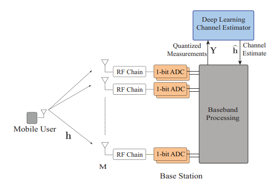
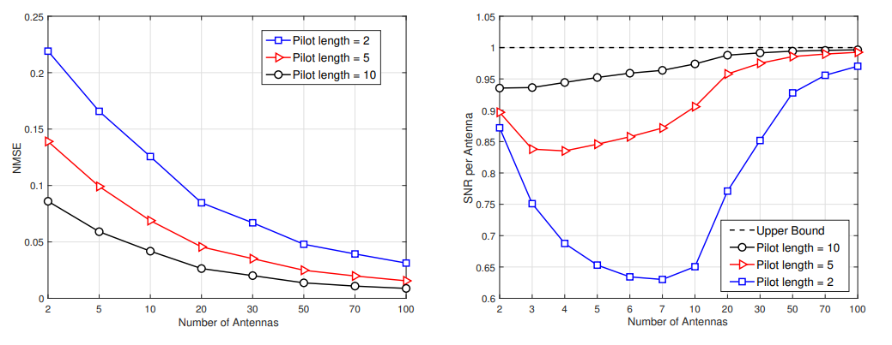

# Deep Learning-Based 1-Bit ADC for Massive MIMO Technology: The More Antennas, the Less Required Pilot Signals

This article focuses on the application of 1-bit analog-to-digital converters (ADCs) in uplink massive multiple-input multiple-output (MIMO) systems, and constructs a deep learning-based channel estimation framework. This framework leverages past channel estimation observation data and deep neural network models to learn complex mapping relationships from quantized received measurements to the channel. To this end, researchers derived the necessary length and structure of pilot sequences that ensure the existence of such mapping functions, leading to an interesting and counterintuitive conclusion: when large MIMO base stations employ more antennas with the same pilot sequence length, the proposed deep learning method can achieve superior channel estimation performance. In other words, for achieving the same channel estimation performance, the number of base station antennas increases, requiring fewer pilots. For certain special channel models, this conclusion is also validated analytically. Simulation results not only verify this conclusion but also show that as the number of antennas increases, both normalized mean square error (NMSE) and the SNR per antenna achieve better channel estimation performance.
Introduction: The use of low-resolution analog-to-digital converters (ADCs) in large-scale MIMO systems holds promise for reducing power consumption while maintaining good realizable rate performance. Over the past few years, these advantages have attracted increasing research attention [1,2]. However, one major challenge faced by such systems is how to implement channel estimation from highly quantized measurement values. Although various channel estimation techniques have been proposed in the literature [1,2], these approaches often require substantial training overhead (i.e., long pilot sequences), significantly impacting the practical application feasibility of low-resolution ADCs in mmWave and large-scale MIMO systems. This paper aims to address these challenges and promote the application of low-resolution ADCs in large-scale MIMO systems.
The research contribution focuses on the channel estimation problem in large-scale MIMO systems equipped with 1-bit ADCs, proposing a deep learning-based framework. This framework utilizes past channel estimation observation data and deep neural networks to learn the mapping relationship from the received quantized measurement values to the channel. However, to learn this mapping, it is first necessary to ensure its existence. To this end, researchers derived the length and structure of pilot sequences that guarantee the existence of the mapping relationship between quantized measurement values and the channel. Subsequently, an interesting conclusion was drawn: for the same set of candidate user positions, the more antennas there are, the fewer pilots are needed to ensure the existence of the mapping relationship. This means that increasing the number of base station antennas will reduce the number of pilots required to estimate the channel, which seems counterintuitive but has a reasonable logic behind it: the more antennas there are, the more unique the quantized measurement vectors corresponding to different channels become, thus enabling efficient mapping to the corresponding channels with lower error probability. For single-path channels, this conclusion was also proven analytically. Simulation results based on publicly available 3D ray-tracing datasets highlighted the excellent advantages of the proposed deep learning method - requiring only a small number of pilots to efficiently estimate large-scale MIMO channels. Additionally, the results confirmed that the more antennas there are, the better the channel estimation performance is, both in terms of normalized mean square error (NMSE) and per antenna SNR.
Researchers have previously not conducted research on channel estimation based on deep learning for large-scale MIMO systems equipped with 1-bit ADCs, nor have they found the interesting conclusion that "the more antennas there are, the fewer pilots required." However, in recent years, some related issues have attracted widespread research attention [1-6]. In [1,2], researchers utilized classical signal processing (non-machine learning) tools to design a low-complexity ML data detector [1] and developed efficient channel estimation techniques for large-scale MIMO and mmWave systems. However, these solutions share a common issue: achieving good data detection or channel estimation performance requires an extremely long pilot training sequence.
In [3-6], researchers have addressed multiple issues related to 1-bit ADCs using machine learning / deep learning techniques. For example, [3] constructed a machine learning framework for data detection but did not address channel estimation; [4] explored channel estimation issues in OFDM systems but was only applicable to single-antenna systems; [5] developed a deep learning solution for data detection and channel equalization for MIMO systems, but its method was only effective in low-dimensional MIMO scenarios because the proposed network could not converge when there were many antennas; [6] adopted a system with both full-resolution and low-resolution ADCs, but only used signals received by full-resolution ADCs for channel estimation, which is essentially similar to the concept of channel mapping proposed by researchers in [7].
Conclusion This paper constructs a deep learning-based channel estimation framework for large-scale MIMO systems equipped with 1-bit ADCs. The researchers derived the structure and length of pilot sequences that ensure the existence of the channel mapping relationship from quantized measurement values, thereby finding that the more antennas there are, the fewer pilots are needed to ensure the existence of this mapping relationship. This conclusion is both analytically proven and validated through simulation results - simulations show that only a small number of pilots are required to efficiently estimate the large-scale MIMO channels. Additionally, the results indicate that as the number of antennas increases, the SNR per antenna approaches its upper limit, fully demonstrating the promising application prospects of this technology in large-scale MIMO systems.

## Images

<!-- PAYMENT_BLOCK -->

## Get this dataset

- Payment link (Stripe): [Buy now](https://buy.stripe.com/3cs8yP7sY87d0vu9AB)
- Payment QR code: 

<!-- /PAYMENT_BLOCK -->
